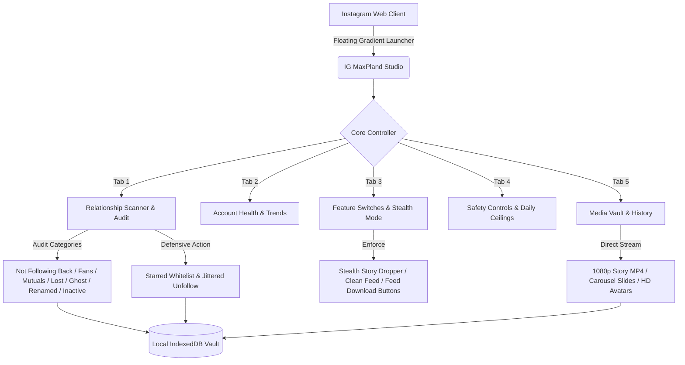

<div align="center">

# IG MaxPland

**Client-Side Relationship Intelligence & Precision HD Media Downloader for Instagram Web**

*High Speed, Zero-Footprint Privacy, Stealth Anti-Detection*  
*Pure Vanilla JavaScript, Single-File Userscript, Zero Dependencies*

[](https://raw.githubusercontent.com/Stxyu-p/ig-maxpland/main/ig_maxpland_en.user.js)
[](https://greasyfork.org/en/scripts/595787-ig-maxpland)
[](https://github.com/Stxyu-p/ig-maxpland)
[](CHANGELOG.md)
[](LICENSE)


</div>

***

## Quick Install

| Channel | Format | Source | Installation Link |
| :--- | :--- | :--- | :--- |
| **GitHub Raw** | Single-File Userscript (v3.3.0) | Direct Repository | [**Install ig_maxpland_en.user.js**](https://raw.githubusercontent.com/Stxyu-p/ig-maxpland/main/ig_maxpland_en.user.js) |
| **Greasy Fork** | Global English Edition (v3.3.0) | Public Registry | [**Install via Greasy Fork**](https://greasyfork.org/en/scripts/595787-ig-maxpland) |

*Compatible with [Tampermonkey](https://www.tampermonkey.net/) (recommended) and [Violentmonkey](https://violentmonkey.github.io/) on Chrome, Edge, Brave, Firefox, and Safari.*

***

## Core Architecture & Privacy Principles

Most Instagram extensions transmit cookies to external proxies, leak tracking telemetry, or execute rapid request loops that trigger Meta account checkpoints.

IG MaxPland runs entirely as a single client-side userscript (`ig_maxpland_en.user.js`) under five strict engineering guarantees:

| Principle | Technical Implementation | Security & Privacy Guarantee |
| :--- | :--- | :--- |
| **100% Client-Side Execution** | Zero telemetry, zero analytics, zero external API relays | Your credentials, session tokens, and data never leave your browser |
| **Native Session Transport** | Uses existing authenticated web session (`X-IG-App-ID`, `X-ASBD-ID`, `csrftoken`) | Zero passwords or login inputs required |
| **Multi-Channel Stealth Dropper** | Native interceptors on `fetch`, `XMLHttpRequest`, and `sendBeacon` | Watch stories anonymously without registering on viewer lists |
| **Anti-Detection Pacing Engine** | Randomized 15-30s jitter, daily write budget, and two-tier rate limits | Replicates human interaction to prevent account flags |
| **Embedded IndexedDB Vault** | Client-side database storage (`IG_MAXPLAND_VAULT` v7) | Snapshots, churn logs, and media history persist locally |

***

## Feature Matrix

| Capability | Generic Scrapers | Common Extensions | IG MaxPland |
| :--- | :---: | :---: | :---: |
| **Architecture** | External Server / CLI | Multi-file Extension | **Single-File Userscript (`.user.js`)** |
| **External Dependencies** | Node modules, Python libs | Bundled node_modules | **Zero Dependencies (Pure Vanilla JS)** |
| **Data Privacy** | Sends data to cloud | Over-permissioned extension | **100% Local (Zero Third-Party Relays)** |
| **Story Seen Blocking** | Not Supported | Frequently leaks beacons | **Complete Telemetry Dropper (All Transports)** |
| **Story HD Downloader** | Broken on MSE streams | Requires external website | **Direct DASH/MSE 1080p Stream Extraction** |
| **Carousel Slide Precision** | Always downloads slide 1 | Unreliable slide capture | **Active Slide Viewport Detection** |
| **Clean Feed Engine** | None | Freezes viewport or shifts layout | **Zero-Height Anchor Locking (`overflow-anchor: none`)** |
| **Relationship Scanning** | Aggressive API flooding | Basic follower compare | **Cold-Start Hydration + Churn 30d Diffing** |
| **Unfollow Safety** | High ban risk | Fixed interval loops | **Randomized 15-30s Pacing + Daily Write Budget** |
| **Whitelist Protection** | None | Session-only memory | **Starred Whitelist with JSON Backup/Restore** |

***

## System Capabilities



### 1. Relationship Intelligence & Cold-Start Hydration
- **Cold-Start Hydration:** Opening the studio modal instantly computes and displays relationship buckets from your latest cached snapshot in under 50ms without hitting Instagram endpoints.
- **Audit Categories:**
  - **Not Following Back:** Accounts you follow who do not follow you back.
  - **Fans:** Accounts following you whom you do not follow back.
  - **Mutuals:** Reciprocal connections (protected by default).
  - **Recently Lost:** Accounts that unfollowed you since your previous scan.
  - **Lost 30d (Churn History):** Historical record of all unfollowers detected across 30 scan cycles with exact detection timestamps.
  - **Ghost Accounts:** Followers who have no profile picture.
  - **Renamed Accounts:** Followers who changed their `@username` between scan cycles.
  - **Inactive Radar:** Following accounts dormant beyond your configured threshold (90, 180, 365 days).
- **Bulk Whitelist Action:** Select multiple accounts with checkboxes and add them to your protected Whitelist with one click.
- **Enriched CSV Export:** Export visible accounts with User ID, Username, Full Name, Verified status, Private status, Category, Whitelisted status, and direct profile URLs.

### 2. Stealth Story Viewer & Direct HD Downloader
- **Ghost Mode:** Automatically intercepts and silences seen beacons sent to `/api/v1/stories/reel/seen/`, GraphQL `StoriesSeen` operations, and `navigator.sendBeacon`.
- **Direct 1080p Video Extraction:** Penetrates React Fiber internal trees to extract pristine HD video streams (`hdSrc`) and DASH representations from MediaSource Extensions (MSE) blobs.
- **Floating Story Toolbar:** Appears seamlessly at the top right of active stories:
  - `👁️ Stealth Toggle`: Switch ghost mode on or off instantly.
  - `⬇ Download HD`: Download full-resolution story videos (MP4) or photos (JPG) directly to disk.
  - `↗ Open Raw`: Open the raw media CDN stream in a fresh tab.
  - `👁 Viewers`: View the audience list for your own uploaded stories.

### 3. Precision Feed Downloader & Active Carousel Detection
- **Active Slide Viewport Detection:** When downloading from a multi-item carousel post, the engine calculates the exact centered slide in your viewport, ensuring you download the slide you are currently looking at rather than defaulting to slide 1.
- **In-Feed Action Trigger:** Minimal action button embedded adjacent to the native bookmark icon on every feed card.
- **Single-Click / Double-Click Actions:** Open the download popover menu or double-click to immediately stream the active asset to disk.

### 4. Centered Profile HD Avatar Downloader
- **Native Header Integration:** Injects a clean, centered `HD Avatar` button directly underneath the user avatar on any Instagram profile page.
- **Perfect Geometric Alignment:** Automatically aligns with zero horizontal drift relative to the profile image container.
- **Uncompressed Resolution:** Fetches full uncompressed profile pictures (`profile_pic_url_hd`) directly from Meta endpoints.

### 5. Clean Feed Engine
- **Layout Shift Elimination:** Uses `visibility: hidden; height: 0` combined with `overflow-anchor: none !important` to hide sponsored advertisements and suggested posts without triggering viewport scroll jumps.
- **SPA Resilience:** Observes mutations from `document.body`, surviving full Single-Page Application (SPA) view transitions without detached observer leaks.

### 6. Instagram-Branded Squircle Launcher
- **Modern Aesthetics:** Floating launcher button rendered with Instagram brand gradient (`#f09433` to `#bc1888`) and squircle border radius matching native mobile icon design.
- **Draggable & Persistent:** Drag anywhere on the screen; coordinates are automatically remembered across browser sessions in local storage.

***

## Anti-Detection & Safety Envelope

Meta deploys automated rate anomaly detection. IG MaxPland enforces strict behavioral guards:

| Safety Parameter | Value | Enforcement Mechanism |
| :--- | :--- | :--- |
| **Unfollow Action Pacing** | 15 - 30 seconds | Cryptographically random jitter delay between individual unfollow requests |
| **Daily Unfollow Ceiling** | 180 actions / day | Hard stop at the action boundary; configurable to 90, 180, 300, or off |
| **Relationship Scan Pacing** | Mode A: 6 - 12 s/page | Serial page requests with randomized pauses and 60-120s breathing rests |
| **Balanced / Fast Pacing** | Mode B: 3 - 6 s / Mode C: 1.5 - 3 s | Faster serial pacing with explicit user safety confirmations |
| **Rate Limit Backoff** | 10 minutes | Automatically pauses queue on HTTP 429 response until cooldown expires |
| **Account Block Lockdown** | 6 hours persistent latch | Locks all API actions on `feedback_required` to protect the account |
| **Whitelist Armor** | Local Map | Prevents unfollow requests for starred users across all UI paths |

***

## Shortcuts & Controls

| Shortcut / Trigger | Location | Action |
| :--- | :--- | :--- |
| <kbd>Alt</kbd> + <kbd>Shift</kbd> + <kbd>M</kbd> | Global | Open or close the IG MaxPland Studio modal |
| **Floating Launcher** | Bottom Right | Click to open modal, drag to reposition |
| **Story Toolbar** | Active Story | Stealth toggle, Download HD, Open Raw, Viewers |
| **HD Avatar Button** | Profile Header | Download uncompressed profile image |
| **In-Feed Icon** | Post Action Bar | Download single media or full carousel |

***

## Repository Contents

```text
ig-maxpland/
├── ig_maxpland_en.user.js   # Production single-file userscript (Global English)
├── CHANGELOG.md             # Version history and release notes
├── README.md                # Project documentation and specifications
└── LICENSE                  # MIT License
```

***

## License

Distributed under the [MIT License](LICENSE).  
Copyright (c) 2026 P Choke & SORA.
